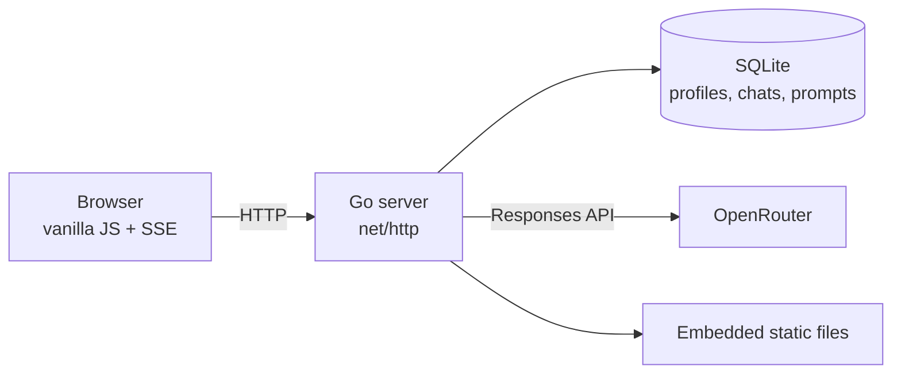

# Clachan

[](https://github.com/SHOWTEX/ClaChan/releases)
[](https://go.dev/)
[](LICENSE)


A small, self-hosted AI chat for your LAN. One static Go binary, SQLite for
history, a vanilla JavaScript interface, and OpenRouter behind the server.
Profiles let your chats and settings follow you between devices. It is designed
to run comfortably on a 1 GB Raspberry Pi 3B+.

## Install

Both installers download the latest release, verify its SHA-256 checksum, and
keep your database and configuration across updates.

### Linux

Requires a 64-bit systemd host (Debian, Ubuntu, or Raspberry Pi OS) and `curl`.

```bash
curl -fsSL https://github.com/SHOWTEX/ClaChan/releases/latest/download/install.sh | sudo bash
```

The installer supports `linux/amd64` and `linux/arm64`. It creates a `clachan`
service user and `/opt/clachan`, writes `/etc/clachan/clachan.env`, asks for your
OpenRouter key, installs a hardened systemd unit, and starts the service. The
database lives in `/opt/clachan/data`. It prints the LAN URL when the health
check passes.

Use a 64-bit Raspberry Pi OS. 32-bit ARM builds are not published.

### Windows

Requires Windows 10 or 11, x64 or ARM64:

```powershell
powershell -NoProfile -ExecutionPolicy Bypass -Command "irm https://github.com/SHOWTEX/ClaChan/releases/latest/download/install.ps1 | iex"
```

The installer is per user and does not need administrator rights. It installs to
`%LOCALAPPDATA%\Clachan`, asks for your OpenRouter key, registers a start-at-login
task, starts the server, and opens the browser. The Start Menu gets **Clachan**,
**Stop Clachan**, and **Uninstall Clachan** shortcuts.

The Windows binary is unsigned, so SmartScreen may show a warning. Choose **More
info → Run anyway**. If Windows Firewall asks, allow Clachan on **Private
networks**. To add the rule explicitly, run this from an elevated PowerShell:

```powershell
powershell -NoProfile -ExecutionPolicy Bypass -Command "& ([scriptblock]::Create((irm https://github.com/SHOWTEX/ClaChan/releases/latest/download/install.ps1))) -OpenFirewall"
```

### First run

Open `http://<server-address>:7654` on Linux, or <http://localhost:7654> on
Windows. The first visit creates the owner profile. No accounts, conversations,
custom presets, or API keys are shipped with the repository.

## Update

Run the same install command again. The installer stops the old process, verifies
and swaps the binary, restarts Clachan, and leaves the database and `.env`
untouched. Schema migrations run automatically at startup.

```bash
# Linux
curl -fsSL https://github.com/SHOWTEX/ClaChan/releases/latest/download/install.sh | sudo bash

# Windows
powershell -NoProfile -ExecutionPolicy Bypass -Command "irm https://github.com/SHOWTEX/ClaChan/releases/latest/download/install.ps1 | iex"
```

To pin a version, download the installer and pass `--release v1.0.5` (Linux) or
`-Release v1.0.5` (Windows).

## Uninstall

Linux, keeping configuration and data:

```bash
curl -fsSL https://github.com/SHOWTEX/ClaChan/releases/latest/download/install.sh | sudo bash -s -- --uninstall
```

Linux, removing everything:

```bash
curl -fsSL https://github.com/SHOWTEX/ClaChan/releases/latest/download/install.sh | sudo bash -s -- --uninstall --purge --yes
```

Windows: use **Start Menu → Clachan → Uninstall Clachan**, or run:

```powershell
powershell -NoProfile -ExecutionPolicy Bypass -File "$env:LOCALAPPDATA\Clachan\install.ps1" -Uninstall
```

Uninstall keeps each platform's configuration and database by default. Add
`--purge --yes` on Linux or `-Purge -Yes` on Windows to delete those as well.

## What it does

- Streaming chat with OpenRouter (SSE, flushed per frame, so tokens appear as
  they arrive)
- Profiles with passwords: chats, prompts, and settings are isolated per profile
  and available on any device signed into it
- Conversation history in SQLite, scoped to the profile
- Authenticated OpenRouter catalogue with context, price, and capability badges;
  searchable, filterable, and sortable in both directions
- Per-conversation provider routing: balanced, cheapest, fastest, lowest
  latency, or a pinned endpoint with color-coded p50 stats
- Per-profile default model, assistant name, default system prompt, and user
  profile (your name and context)
- System prompt presets: built-in Assistant, Coder, Minimal, Researcher, Editor,
  and Teacher, plus custom presets saved from any system prompt
- Prompt library with per-profile CRUD, search, insert, and “use as system”
- OpenRouter server tools: per-chat web search/web fetch switch with a custom
  tool-call cap, always-on date/time and model-catalog search, and numbered
  assistant step cards with collapsible reasoning, tool arguments, results, and
  source citations
- Collapsible reasoning blocks on replies, plus a per-chat reasoning-effort
  menu fed by the model catalogue (`supported_efforts` / `default_effort`)
- Image, PDF, and text attachments: images are downscaled in the browser before
  upload, text/code files are sent as text parts, and all attachments are stored
  in SQLite so messages replay after a reload
- Named themes: Dark, Light, Midnight, Midnight purple, Forest, Sepia; applied
  instantly from Settings
- Markdown rendering with file cards: inferred filename, language, size, raw-text
  viewer, download, and print/save-as-PDF
- Export a conversation as Markdown or JSON, or print it to PDF; import a JSON
  export back into the signed-in profile
- Edit, regenerate, delete, and copy message actions
- Rename, delete, and switch conversations from a sidebar
- Per-conversation system prompt
- Works on a phone over the LAN: off-canvas sidebar, touch targets, safe areas
- Models fetched at startup, cached in memory, and never re-proxied on page
  load

No telemetry, no Node/npm, no build step for the frontend. Profiles are local to
your server — no email, no cloud account.

## Architecture



The browser never talks to OpenRouter and never sees the API key. The server
rebuilds conversation history from SQLite for every request, streams upstream
events to the browser, and writes the completed assistant message back to the
database.

## Requirements

**Build machine**

- Go 1.27 or newer
- No CGO: `modernc.org/sqlite` is a pure-Go SQLite

**Release targets**

- Linux `amd64` and `arm64`, with systemd
- Windows 10/11 `amd64` and `arm64`
- About 11-12 MB for the binary, plus the database
- No runtime dependencies

**Account**

- An [OpenRouter](https://openrouter.ai) API key

## Build

From the repository root, in PowerShell:

```powershell
.\build.ps1
```

`build.ps1` runs `gofmt`, `go vet`, and `go test`, then cross-compiles and
verifies the result is `linux/arm64`. The actual build is exactly:

```powershell
$env:GOOS="linux"; $env:GOARCH="arm64"; $env:CGO_ENABLED="0"
go build -trimpath -ldflags "-s -w -X main.version=1.0.5" -o clachan .
```

The tagged release workflow builds all four release targets. To do the same
locally, set `GOOS` and `GOARCH` to one of `linux/amd64`, `linux/arm64`,
`windows/amd64`, or `windows/arm64`:

```bash
CGO_ENABLED=0 GOOS=linux GOARCH=arm64 \
  go build -trimpath -ldflags "-s -w -X main.version=1.0.5" -o clachan .
```

Do **not** use a Windows build for Linux deployment: it fails with `Exec format
error`. The resulting binary embeds the frontend; nothing else needs to be copied
alongside it except the database and environment file.

Building needs no API key. The key is only read when the server starts.

## Development

From a checkout, with Go 1.27 or newer:

```bash
cp .env.example .env
# edit .env and set OPENROUTER_API_KEY
go run .
```

Open <http://localhost:7654>. The first visit creates the owner profile.

For a disposable development database, point `CLACHAN_DB` at a temporary file:

```bash
CLACHAN_DB=/tmp/clachan-dev.db go run .
```

Before opening a pull request, run:

```bash
gofmt -l .
go vet ./...
go test ./...
node --check static/app.js   # optional; the frontend has no build step
```

CI runs formatting, vet, test, installer, and all four release-target build
checks on every push to `main` and every pull request. See
[CONTRIBUTING.md](CONTRIBUTING.md) for the full contributor guide.

## Configure

Copy the example file and fill it in:

```powershell
Copy-Item .env.example .env
notepad .env
```

`.env` is gitignored. Real environment variables take precedence over the file,
so a systemd `EnvironmentFile` wins.

The file has the same format everywhere:

- **Linux installer:** `/etc/clachan/clachan.env`
- **Windows installer:** `%LOCALAPPDATA%\Clachan\.env`
- **From source:** `.env` in the working directory

The SQLite database is created on first start. To reset an installation, stop
the service and delete the database file (and its `-wal`/`-shm` companions); the
next visit returns to the first-run owner setup. The installers keep the
database and configuration when updating or uninstalling unless you ask them to
purge.

| Variable | Default | Purpose |
|---|---|---|
| `OPENROUTER_API_KEY` | *(empty)* | Required. Server-side only; never sent to the browser. |
| `CLACHAN_ADDR` | `:7654` | Listen address. Use `:7654` for LAN access. |
| `CLACHAN_DB` | `./data/clachan.db` | SQLite file. Its parent directory is created if missing. |
| `DEFAULT_MODEL` | `deepseek/deepseek-v4.1-flash-1017` | Model for new conversations. |
| `DEFAULT_SYSTEM_PROMPT` | *(empty)* | Seeded into new conversations. |
| `OPENROUTER_BASE_URL` | `https://openrouter.ai/api/v1` | Upstream API base. |
| `OPENROUTER_REFERER` | `https://github.com/SHOWTEX/ClaChan` | Sent as `HTTP-Referer` (OpenRouter attribution). |
| `OPENROUTER_TITLE` | `Clachan` | Sent as `X-Title`. |

`OPENROUTER_REFERER` defaults to the project repository, so OpenRouter
attribution identifies Clachan. Forks should override it with their own URL.

The server starts without a key and serves the UI, but chat requests are
rejected with a clear message until `OPENROUTER_API_KEY` is set.

## Manual deployment

The installers above are recommended. Use this section for a custom layout, an
offline install, or a system where you want to manage the service yourself. Do
not edit source files on the Pi.

**1. One-time setup on the Pi**

```bash
sudo groupadd --system clachan 2>/dev/null || true
sudo useradd --system --gid clachan --home /opt/clachan --shell /usr/sbin/nologin clachan 2>/dev/null || true
sudo install -d -m 0755 -o clachan -g clachan /opt/clachan /opt/clachan/data
sudo install -d -m 0750 -o root -g clachan /etc/clachan
```

**2. Copy the binary and configuration**

From the build machine:

```powershell
scp .\clachan pi@raspberrypi.local:/tmp/clachan
scp .\.env pi@raspberrypi.local:/tmp/clachan.env
ssh pi@raspberrypi.local "sudo install -m 0755 /tmp/clachan /opt/clachan/clachan && sudo install -m 0640 -o root -g clachan /tmp/clachan.env /etc/clachan/clachan.env && rm /tmp/clachan /tmp/clachan.env"
```

**3. systemd unit**

Create `/etc/systemd/system/clachan.service`:

```ini
[Unit]
Description=Clachan
After=network-online.target
Wants=network-online.target

[Service]
Type=simple
User=clachan
Group=clachan
WorkingDirectory=/opt/clachan
EnvironmentFile=/etc/clachan/clachan.env
ExecStart=/opt/clachan/clachan
Restart=on-failure
RestartSec=3
TimeoutStopSec=15
NoNewPrivileges=true
PrivateTmp=true
ProtectSystem=strict
ProtectHome=true
ReadWritePaths=/opt/clachan/data

[Install]
WantedBy=multi-user.target
```

Enable and start it:

```bash
sudo systemctl daemon-reload
sudo systemctl enable --now clachan
sudo systemctl status clachan
```

Then open `http://<pi-address>:7654` from any device on the LAN.

The first visit asks you to create the **owner** profile. The owner can add more
profiles from the profile chip at the bottom of the sidebar. Each profile has its
own chats, prompts, and settings. If you have conversations from before profiles
existed, the first profile claims them.

**Updating manually**

The installer does this in one command, but the manual equivalent is:

```powershell
.\build.ps1
scp .\clachan pi@raspberrypi.local:/tmp/clachan
ssh pi@raspberrypi.local "sudo install -m 0755 /tmp/clachan /opt/clachan/clachan && rm /tmp/clachan && sudo systemctl restart clachan"
```

The database, `.env`, and service configuration are not touched.

## Releases

Tagged releases are built by GitHub Actions for all four targets:

```bash
git tag -a v1.0.5 -m "v1.0.5"
git push origin v1.0.5
```

The workflow attaches the four binaries, `install.sh`, `install.ps1`, and
`checksums.txt` to the release. The installers target `SHOWTEX/ClaChan`; forks
can override that with `--repo` or `-Repo`. CI also runs the test suite before
publishing.

## API

Public routes:

| Method | Path | Purpose |
|---|---|---|
| `GET` | `/healthz` | Liveness, active stream count, DB status. |
| `GET` | `/api/auth/status` | Setup state, public profile names for the login picker, and the signed-in profile with its settings. |
| `POST` | `/api/auth/setup` | First run only. Creates the owner profile and signs in. |
| `POST` | `/api/auth/login` | Sets an HttpOnly session cookie. |
| `POST` | `/api/auth/logout` | Deletes the session. |

Session required:

| Method | Path | Purpose |
|---|---|---|
| `POST` | `/api/chat` | Stream a reply as SSE. Body: `conversationId`, `content`, optional `attachments` (image/PDF/text parts), `toolsEnabled`, `maxToolCalls`, `reasoningEffort`, `timezone`, `provider`, `model`, `action` (`regenerate`, `edit`), `messageId`. Events include `meta`, `delta`, `reasoning`, `step`, `citation`, `done`, and `error`. |
| `GET` | `/api/conversations` | List conversations with a preview and the saved reasoning effort. |
| `POST` | `/api/conversations` | Create a conversation, including initial `toolsEnabled`, `maxToolCalls`, and `reasoningEffort`. |
| `POST` | `/api/conversations/import` | Import a JSON conversation export into the signed-in profile. |
| `GET` | `/api/conversations/{id}` | Full history, including reasoning, tool steps, citations, and tool summaries. |
| `PATCH` | `/api/conversations/{id}` | Rename, system prompt, provider/model, provider routing, or tool/reasoning settings (`toolsEnabled`, `maxToolCalls`, `reasoningEffort`). |
| `DELETE` | `/api/conversations/{id}` | Delete a conversation and its messages. |
| `DELETE` | `/api/messages/{id}` | Delete one message. |
| `GET` | `/api/prompts` | List this profile's saved prompts. |
| `POST` | `/api/prompts` | Create a prompt (`title`, `body`, optional `system`). |
| `PATCH` | `/api/prompts/{id}` | Update a prompt's title, body, or system-preset flag. |
| `DELETE` | `/api/prompts/{id}` | Delete a prompt. |
| `GET` | `/api/models` | Cached authenticated catalogue with pricing and capability metadata. |
| `GET` | `/api/model-endpoints?model=author/slug` | Cached provider endpoints with p50 latency/throughput, uptime, quantization, and native tools. |
| `POST` | `/api/auth/password` | Change your password (requires the current one). |
| `PATCH` | `/api/profile` | Change profile settings: default model, assistant name, default system prompt, your name/context, and ignored provider slugs. |
| `GET` | `/api/profiles` | Owner only. List profiles. |
| `POST` | `/api/profiles` | Owner only. Create a profile. |

The browser never sends the transcript: the server rebuilds history from
SQLite. `POST /api/chat` is used instead of `EventSource` because the browser
must send a request body and read the stream with `fetch`.

## Behaviour worth knowing

- **Profiles.** The first profile is the owner; only the owner can create more.
  Passwords use PBKDF2-HMAC-SHA256 (210k iterations), sessions are 30-day
  HttpOnly `SameSite=Lax` cookies, and only the SHA-256 hash of a session token
  is stored. Changing a password signs out that profile's other devices.
  Conversations, messages, prompts, and settings are always scoped to the
  signed-in profile.
- **Password recovery.** There is no reset screen. If the owner forgets the
  password, stop the service and run `./clachan -reset-password <name>` on the
  Pi; it prints a new temporary password and signs out that profile's sessions.
- **The model list is authenticated.** Clachan calls `/models/user`, so the
  catalogue reflects the key's provider preferences, privacy settings, and
  guardrails. It keeps a lean copy in memory with price, context, and
  Vision/Files/Tools/Reasoning capability flags, then refreshes in the
  background. Reasoning models also carry their supported efforts and default
  effort for the composer menu. The browser gets that lean copy, never the
  upstream megabyte.
- **Provider routing is per conversation.** Balanced is OpenRouter's default load
  balancing. Cheapest/fastest/lowest-latency map to `provider.sort`. A pinned
  endpoint sends `provider.only` with an optional `allow_fallbacks: false`.
  Endpoint details are fetched on demand and cached for ten minutes. Unavailable
  endpoints are hidden. Throughput, p50 latency, uptime, and quantization are
  colour-coded (green/amber/red); quantization colours adapt to whether any
  endpoint in the list is better than FP8. Uptime is the 24-hour figure (the
  30-minute number is usually exactly 100); the 30-minute value is in the
  tooltip.
- **Ignored providers are profile settings.** Use OpenRouter provider slugs, not
  the display names shown on the privacy page: “Open Inference” is
  `open-inference`, “Sail Research” is `sail-research`. Slugs also appear as
  endpoint tags in Provider routing. Clachan hides matching endpoints and sends
  `provider.ignore` on every chat request. OpenRouter does not expose account-wide
  ignored providers through its public API, so this list starts empty and must be
  entered once per profile.
- **Default model is per profile.** Set it in Settings; it applies to new chats
  and syncs across devices. Existing conversations keep their own model.
- **Tools are per conversation.** The message-bar toggle controls
  `openrouter:web_search` and `openrouter:web_fetch`; the last state is remembered
  for new chats. The max-call field (1–30) sets OpenRouter's top-level
  `max_tool_calls` budget. `openrouter:datetime` and
  `openrouter:experimental__search_models` are always included because they are
  free and low-risk.
- **Replies use the OpenResponses API.** Chats go to `POST /responses`, not
  `/chat/completions`, because Responses exposes server-tool output items and
  reasoning items. Clachan stores them on the assistant message (`steps`,
  `reasoning`) and renders each tool call as its own numbered card: collapsible
  reasoning, arguments, result, and sources. Arguments and results start
  collapsed so long tool transcripts stay compact. The final answer is the last
  card.
  Provider-native search may return only a query and final citations; the
  Exa-backed engine also returns source URLs and short excerpts. Web-search and
  web-fetch pricing depends on the engine `auto` selects (native provider first,
  otherwise Exa by default; OpenRouter's own fetch engine is free). Date/time
  and model-catalog search have no separate tool fee.
- **Reasoning effort is per conversation.** The model catalogue supplies
  `reasoning.supported_efforts`, `default_effort`, and `default_enabled`; the
  message-bar menu lists only the efforts that model actually accepts, with no
  synthetic Auto row. Before a choice is saved, the model's reported default is
  shown and marked as selected. `reasoningEffort` is stored on the conversation,
  mirrored to profile-scoped browser storage, and sent as `reasoning.effort`.
  Models without effort metadata hide the menu.
- **Persona and user profile are separate.** The assistant name labels replies
  and is added to the system prompt as “Your name is X.” unless the instructions
  already mention it. The default system prompt applies to new conversations;
  existing conversations keep their own. “Your name” and “About you” are
  profile-level context appended to every chat's system prompt.
- **System prompt presets.** Settings has a preset picker above each system
  prompt field. Built-ins are frontend constants; custom presets are prompt
  records with `system: true`, so they sync across devices with the profile.
  “Save as preset” opens the prompt form prefilled with the current prompt.
- **Presets describe their capabilities.** Every built-in preset ends with
  shared `## Formatting` and `## Tools and attachments` sections. The formatting
  section lists the Markdown the renderer supports and notes that raw HTML is
  escaped. The tools section explains that images, PDFs, and UTF-8 text/code
  files can be attached, that web search/fetch depend on the chat's tool switch,
  and that date/time and model search are always available.
  When adding a tool, update `TOOL_GUIDE` in `static/app.js` so every preset
  describes the new capability instead of letting the model guess or claim
  access it does not have.
- **Prompt library is per profile.** Prompts are stored in SQLite and scoped by
  `profile_id`. "Insert" appends to the composer; "System" sets the current
  conversation's system prompt. System presets are marked in the library. Prompt
  bodies can be up to 1 MB and titles up to 200 characters.
- **Generated files stay in the browser.** Fenced code blocks become file cards
  with an inferred filename, language, size, raw-text viewer, and download.
  Downloads are browser Blobs. Print/save-as-PDF and conversation export also
  happen entirely in the browser.
- **Attachments are stored in SQLite, not on disk as files.** Images are
  downscaled in the browser to at most 1600 px and re-encoded as JPEG before
  upload. PDFs are sent as Responses `input_file` parts with their filename and
  data URL. UTF-8 text and code files are validated in the browser and sent as
  text parts with their filename. Limits are 6 attachments, 8 MB per
  image, 12 MB per PDF, 4 MB per text file, and 24 MB total. The validated data
  URLs are saved with the user message, so images and file cards reappear after
  reload; PDF output remains browser print/save-as-PDF.
- **Import accepts JSON exports.** The import button reads either a full export
  envelope (`{"conversation": …}`) or a bare conversation object. The server
  assigns fresh conversation and message IDs, validates every attachment, and
  scopes the result to the signed-in profile. Reasoning, tool steps, citations,
  and tool summaries are preserved. Imports are capped at 2,000 messages
  and 64 MB of JSON.
- **Themes** are six named palettes selected in Settings and stored in browser
  local storage. Selecting one applies it immediately; Save is not required.
- **Sorting.** Model and endpoint sorts work in both directions. Price sorting
  uses the sum of input and output USD per million tokens; input-only and
  output-only model sorts are also available.
- **Two streams maximum.** A third concurrent generation gets `503` immediately.
  There is no queue. The Pi does not degrade gracefully under load.
- **One write per reply.** The assistant text is buffered in memory and inserted
  once when the stream ends. A client disconnect or stopped generation keeps the
  partial reply.
- **No server-side retries on 429.** OpenRouter's rate-limit response is passed
  to the browser with `Retry-After`; the UI shows the error, counts down, and
  makes one jittered retry that you can cancel.
- **SQLite** runs in WAL mode with `synchronous=NORMAL`, `busy_timeout=5000`,
  and a single connection.

## Troubleshooting

- **Linux service:** `sudo systemctl status clachan` and
  `sudo journalctl -u clachan -n 50 --no-pager`.
- **Windows logs:** `%LOCALAPPDATA%\Clachan\logs`. Use the Start Menu's **Stop
  Clachan** and **Clachan** shortcuts after editing `.env`.
- **Port already in use:** change `CLACHAN_ADDR` in the config file and restart
  the service (Linux) or use Stop/Open Clachan (Windows).
- **Another device cannot connect:** allow TCP 7654 on the private network in
  the firewall, and confirm the server is bound to `:7654` rather than
  `127.0.0.1:7654`.
- **Update checksum failure:** retry the download. Do not bypass checksum
  verification; a partial or tampered asset should not be installed.

## Security

Clachan is for a **trusted LAN**. Do not expose it to the internet or port-forward
it.

Profiles are real logins, not cosmetic:

- PBKDF2-HMAC-SHA256 with a 16-byte salt and 210,000 iterations; passwords never
  reach the browser and are never logged.
- 32-byte session tokens; the database stores only their SHA-256 hashes. The
  cookie is `HttpOnly`, `SameSite=Lax`, lasts 30 days, and gains `Secure`
  automatically if the server is ever served over TLS.
- Owner-only profile creation, per-IP login throttling, and an `Origin` check on
  every mutating request.
- Every conversation, message, prompt, and setting query is scoped to the
  signed-in profile. Guessing another profile's conversation ID returns `404`.
- The public login picker receives profile names and owner flags only. Persona
  prompts, user context, default models, and ignored provider lists are returned
  only for the signed-in profile.

**The honest caveat:** over plain HTTP on the LAN, passwords and session cookies
travel in cleartext. Profiles give separation between people sharing the server,
not protection from someone who can sniff your network. Keep it on a trusted
network, or put TLS in front of it.

- API keys stay on the server. The browser only ever talks to Clachan.
- All profiles share the server's OpenRouter key and credits; there are no
  per-profile keys.
- The app ships a strict CSP; there is no inline script or style.
- Model output is parsed into DOM nodes with `textContent`; raw HTML from the
  model is never injected. Links are limited to `http`/`https`.
- `.env`, databases, and build output are gitignored. `.env.example` contains no
  secrets.

## Project layout

```
main.go         server wiring, graceful shutdown, embedded static files
config.go       environment and minimal .env loader
provider.go     OpenRouter client, shared HTTP client, model and endpoint caches
responses.go    Responses event parsing, reasoning, tool steps, citations
store.go        SQLite schema, migrations, profile-scoped queries
auth.go         passwords, sessions, login/profile handlers, middleware
chat.go         POST /api/chat: semaphore, SSE proxy, persistence
tools.go        server-tool payloads, citations, tool-run summaries
attachments.go  attachment validation and OpenRouter content parts
api.go          conversation CRUD, models, health, middleware
cli.go          -version and -reset-password administrative commands
static/         index.html, style.css, app.js (vanilla, embedded)
install.sh      Linux install, update, and uninstall script
install.ps1     Windows install, update, and uninstall script
.github/        CI, tagged release, and dependency-update workflows
build.ps1       cross-compile for linux/arm64
```

## Contributing

Contributions are welcome. Read [CONTRIBUTING.md](CONTRIBUTING.md) for the
development setup, project constraints, and review checklist. Please report
security issues privately as described in [SECURITY.md](SECURITY.md), not in a
public issue.

## License

MIT. See [LICENSE](LICENSE).
